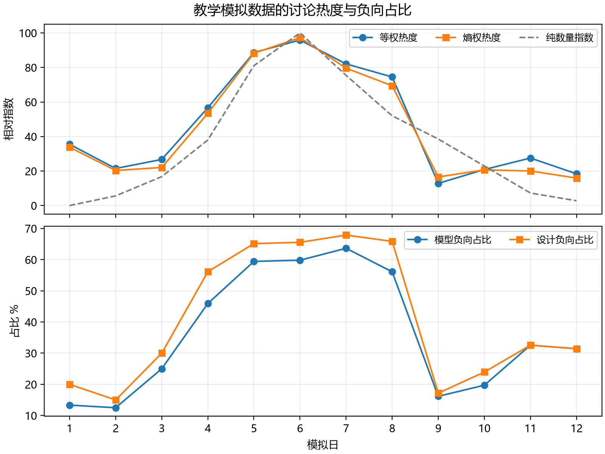

# NLP 文本测度与舆情情感演化研究

期中作业二的毕业论文模拟稿与可复现材料。正文约 9,200 个汉字，包含完整研究设计、测度公式、对照实验、结果分析、参数敏感性检查和研究限制。

**全部数据为教学模拟数据。** 评论、话题、日期和标签由程序构造，不包含真实用户、真实事件或微博采集数据。论文报告的是运行本项目代码得到的计算结果，不能用来证明真实平台的舆情规律。

## 论文与完整材料

- [Word 论文](NLP舆情研究模拟稿.docx)
- [Markdown 论文](paper.md)
- [数据 Excel](研究数据.xlsx)
- [完整材料包](https://github.com/zym1227yyy/nlp-opinion-research/blob/main/research-materials.zip)：原始与处理 CSV、逐日与分阶段结果、词表、模拟配置、错例、图表、数据来源说明、代码和字数统计。
- [核心实验脚本](experiment.py)
- [计算结果摘要](results_summary.json)



## 复现

核心实验仅使用 Python 标准库，Python 3.10 或以上，无需账号、接口密钥或网络。

```bash
python experiment.py --output results
```

固定随机种子为 `20261011`。脚本会重新生成数据与所有数值结果。README 中的 `results` 文件夹内容包含在完整材料 ZIP 中；也可以运行脚本自行生成。

需要重新绘图时，解压完整材料，在项目目录执行：

```bash
python -m pip install -r requirements.txt
python plot_results.py --results results --output figures
```

绘图依赖 Matplotlib，核心数值计算不依赖它。中文图形使用系统已具备的中文字体。

## 关键结果

| 项目 | 运行结果 |
| --- | --- |
| 原始记录 | 1,360 条 |
| 清洗后记录 | 1,148 条 |
| 保留率 | 84.41% |
| 词典基线准确率 | 73.08% |
| 规则修正准确率 | 94.69% |
| 基线宏平均 F1 | 0.7645 |
| 规则宏平均 F1 | 0.9522 |
| 未正确识别的反讽句 | 61 条 |
| 等权与熵权热度峰值 | 第 6 个模拟日 |

模板与词典存在设计关联，较高准确率是内部功能检查结果。阶段标签、讨论量与情感生成概率预先设定，不是算法发现的真实生命周期。所有比较都按此限制解释。

## 材料结构

完整 ZIP 包含论文 Word 与 Markdown、`研究数据.xlsx`、`experiment.py`、`plot_results.py`、`requirements.txt`、`DATA_SOURCES.md`、`word_count.json`、`results/` 和 `figures/`。

`results/` 内的原始表、处理表和删除表保留独立观察记录。每日与阶段结果分别保存，敏感性表报告分类阈值和特征表示的变化。`simulation_config.json` 提供生成短句及标签，`sentiment_lexicon.csv` 提供自编词表，`checksums.json` 提供结果文件校验值。

Excel 是阅读用的数据快照，全部计算由 Python 完成；Word 已完成内容、结构和表格检查，当前制作环境缺少原生 Word 渲染组件，未完成逐页分页预览。

## 提交地址

https://github.com/zym1227yyy/nlp-opinion-research

文献来源与 DOI 见论文参考文献。项目没有使用所提供初稿中未核查的实验数字或示例仓库地址。
